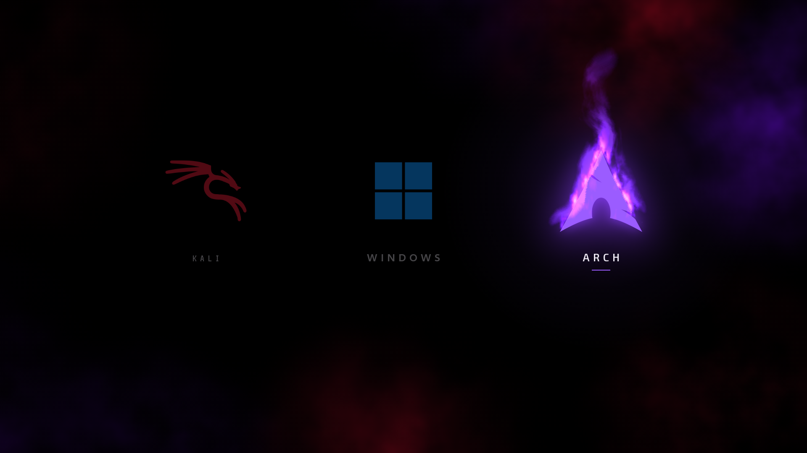
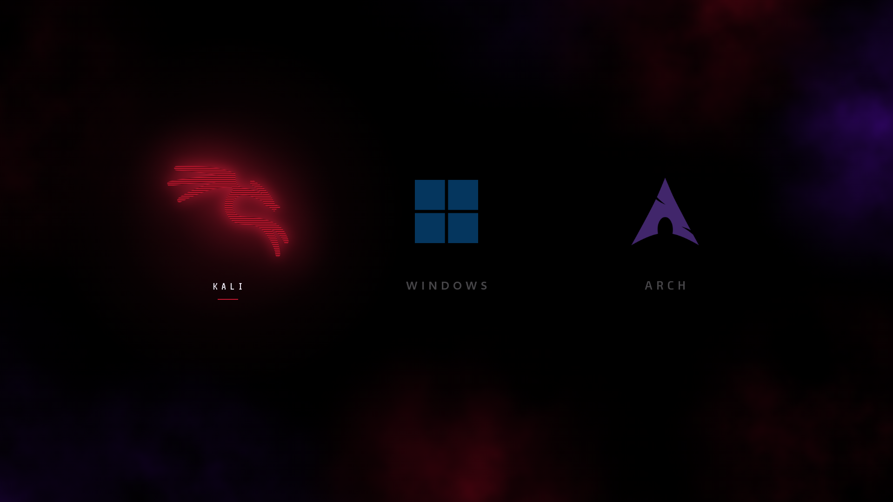
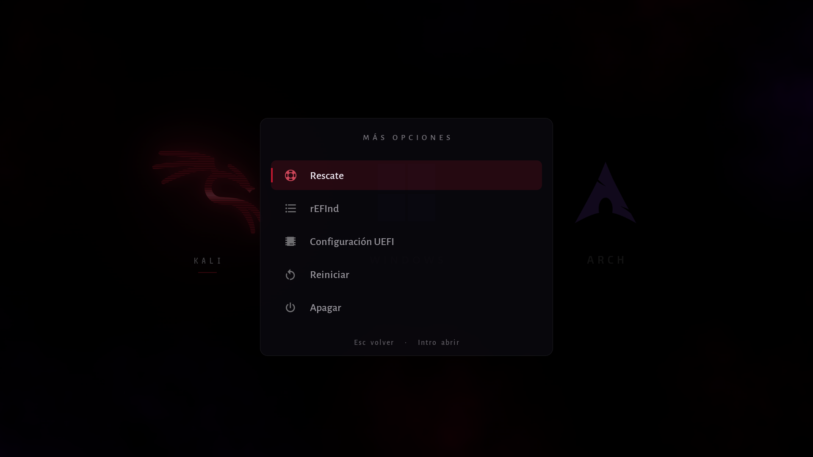

**Español** · [English](README.en.md)

# Menú de arranque

Un menú de arranque animado para elegir sistema al encender el ordenador, hecho desde cero como **programa UEFI en Rust**. Sustituye a la pantalla de GRUB o rEFInd: Windows en el centro, Kali a la izquierda y Arch a la derecha, cada uno con su animación.



| Kali elegido | Más opciones (Esc) |
|---|---|
|  |  |

## Qué hace
- **← →** elegir, **Intro** arrancar. Windows va por defecto y arranca sola a los 10 s; cualquier tecla para la cuenta atrás.
- Cada sistema tiene su efecto al elegirlo (Kali con *glitch*, Windows con un aura azul, Arch con fuego) y su animación al lanzarlo (Kali se apaga como una tele vieja, Windows abre sus cristales hacia la luz, Arch arde como un papel).
- **Esc** abre más opciones: **Rescate** (otro gestor, como Limine), **rEFInd**, **Configuración UEFI** (entra en la BIOS), **Reiniciar** y **Apagar**.
- **F** muestra los fps y lo que tarda cada fotograma.
- Si algo no arranca, avisa en pantalla y vuelve al menú en vez de colgarse.

## Cómo funciona
No hay sistema operativo debajo: el firmware UEFI carga el `.efi` y el programa pinta directamente en la pantalla (GOP, 1920×1080).
- **Todo lo caro se hace al compilar.** `herramientas/sprites.py` (Pillow + numpy) prepara logos, textos, degradados, humo y las texturas del fuego, y los mete en el binario como máscaras. En cada fotograma solo se copian sprites con escala, giro y transparencia.
- **Solo enteros en los bucles de píxeles.** El destino `x86_64-unknown-uefi` va sin SSE, así que la coma flotante es por software (unas 10 veces más lenta). El dibujo usa coma fija.
- **Memoria de vídeo rápida.** Algunos firmwares dejan la memoria de vídeo sin caché (en el equipo original, 25 fps). Al empezar, el menú pone un MTRR libre en *write-combining* (más de 180 fps; se limita a 60) y lo devuelve antes de abrir el sistema elegido.
- **Para arrancar Linux** carga el kernel directamente (EFI stub) con su línea de opciones e `initrd=`; Windows, rEFInd y Limine son `.efi` normales.

## Estructura
| Carpeta | Qué hay |
|---|---|
| `app/` | El programa UEFI (`main.rs` bucle y vídeo, `escena.rs` la escena, `grafico.rs` el dibujo, `arranque.rs` `menu.conf` y lanzar sistemas, `video.rs` el MTRR) |
| `herramientas/` | `sprites.py` genera los recursos; `probar-qemu.py` lo prueba en una máquina virtual y saca capturas |
| `maqueta/` | El diseño en HTML/JS: abre `maqueta/index.html` en el navegador para verlo sin compilar nada |
| `banco/` | El mismo código de dibujo compilado para Windows, para medir el tiempo por fotograma |
| `recursos/` | Tipografías (OFL) y Symbols Nerd Font (MIT), con sus licencias |

## Compilar
Necesitas Rust 1.85 o más nuevo y Python 3 con Pillow y numpy.

```sh
rustup target add x86_64-unknown-uefi
pip install pillow numpy
python herramientas/sprites.py      # genera app/src/recursos.bin y recursos.rs
cd app && cargo build --release
```

Sale `app/target/x86_64-unknown-uefi/release/menu-arranque.efi`.

## Probarlo sin tocar tu equipo
`herramientas/probar-qemu.py` arranca el menú en QEMU con OVMF y sigue un guion de teclas y capturas:

```sh
python herramientas/probar-qemu.py capturas "3,foto:inicio,der,2.5,foto:arch,esc,1,foto:menu"
```

Busca QEMU en `~/herramientas/qemu`: cambia la ruta `QEMU` del script si lo tienes en otro sitio.

## Instalar
> ⚠️ Vas a tocar el arranque. Deja rEFInd, GRUB o el gestor que tengas como segunda entrada para poder volver, y si usas BitLocker, suspéndelo antes (`Suspend-BitLocker -MountPoint C: -RebootCount 2`) o te pedirá la clave de recuperación. El `.efi` no está firmado: con **Secure Boot** activado no arrancará.

1. Copia el programa y su configuración a la partición EFI (en Linux suele estar en `/boot` o `/efi`):
   ```sh
   sudo mkdir -p /boot/EFI/menu-arranque
   sudo cp app/target/x86_64-unknown-uefi/release/menu-arranque.efi /boot/EFI/menu-arranque/
   sudo cp menu.conf.ejemplo /boot/EFI/menu-arranque/menu.conf
   ```
2. Edita `menu.conf` (abajo) con las rutas de tus sistemas.
3. Crea la entrada UEFI y ponla la primera (cambia disco y partición por los de tu partición EFI):
   ```sh
   sudo efibootmgr --create --disk /dev/nvme0n1 --part 1 --label "Menu de arranque" \
     --loader '\EFI\menu-arranque\menu-arranque.efi'
   sudo efibootmgr            # mira el número de la nueva entrada y el orden
   sudo efibootmgr -o XXXX,YYYY,...   # la nueva primero, tu gestor de antes detrás
   ```

### menu.conf
Va siempre en `\EFI\menu-arranque\menu.conf`. Formato `clave = valor`; `#` comenta. Las rutas son dentro de la partición EFI, con `\`.

| Clave | Qué es | Por defecto |
|---|---|---|
| `espera` | Segundos hasta arrancar Windows (1-60) | `10` |
| `windows` | Gestor de Windows | `\EFI\Microsoft\Boot\bootmgfw.efi` |
| `arch`, `arch_opciones` | Kernel de Arch y su línea de opciones, con `initrd=` | — |
| `kali`, `kali_opciones` | Lo mismo para Kali | — |
| `rescate` | Lo que abre «Rescate» | `\EFI\limine\BOOTX64.EFI` |
| `refind` | Lo que abre «rEFInd» | `\EFI\refind\refind_x64.efi` |

```ini
espera = 10
windows = \EFI\Microsoft\Boot\bootmgfw.efi
arch = \EFI\arch\vmlinuz-linux
arch_opciones = initrd=\EFI\arch\initramfs-linux.img root=UUID=xxxx rw quiet
kali = \kali\vmlinuz
kali_opciones = initrd=\kali\initrd.img root=UUID=yyyy rw
```

El kernel y el initrd **tienen que estar en la partición EFI** (el firmware no lee ext4 ni btrfs). Si ya usas rEFInd o systemd-boot, copia las rutas y opciones de su configuración (`refind.conf` o `loader/entries/`). Si tu distribución deja el kernel en otra partición, un hook que lo copie a la EFI tras cada actualización lo resuelve (en Debian y Kali: `/etc/kernel/postinst.d/` y `/etc/initramfs/post-update.d/`).

## Adaptarlo
Está hecho para Windows + Arch + Kali a 1920×1080. Para otros sistemas o colores: los logos y textos salen de `herramientas/sprites.py` (logos de la Nerd Font), los efectos de `app/src/escena.rs`, y conviene probar el cambio antes en la maqueta (`maqueta/menu.js`).

## Licencia
Código bajo [MIT](LICENSE). Las tipografías de `recursos/` tienen su propia licencia (OFL y MIT), incluida junto a cada una. Los logos son marcas de sus dueños.
